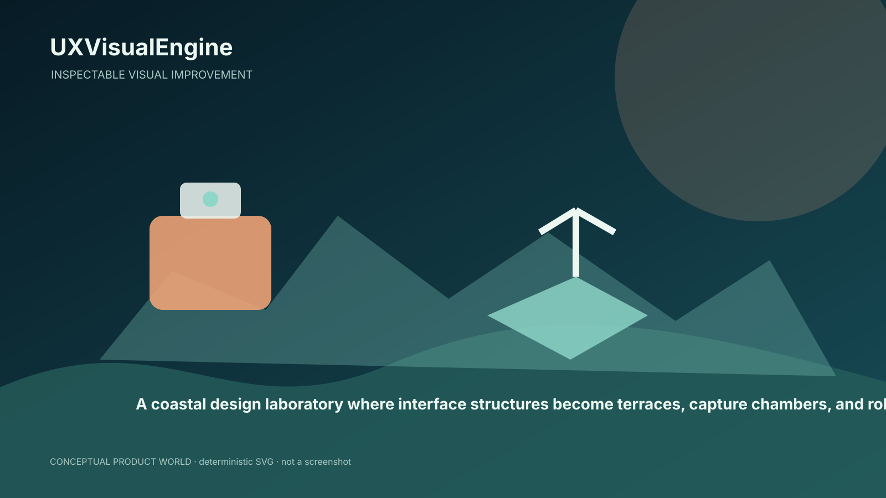
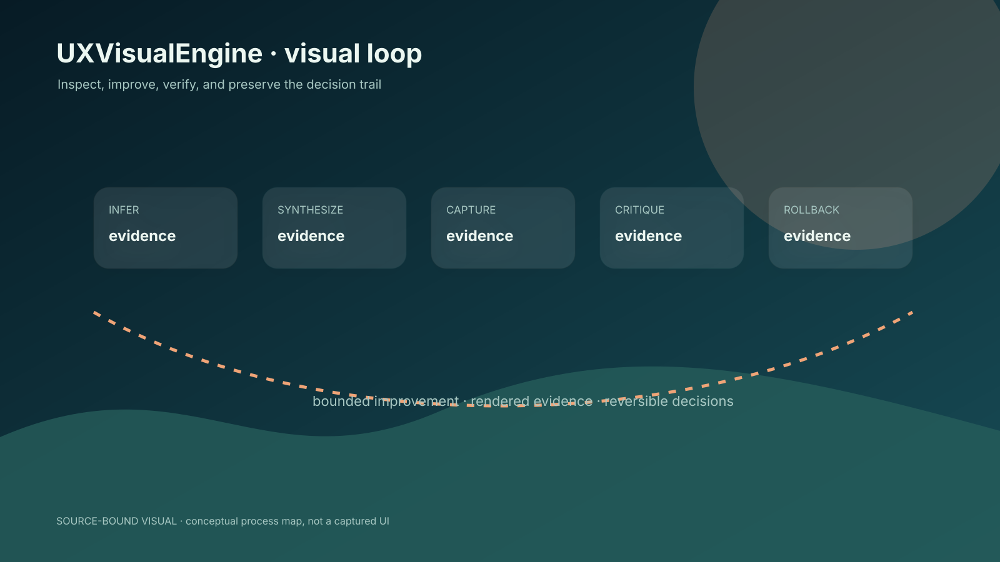
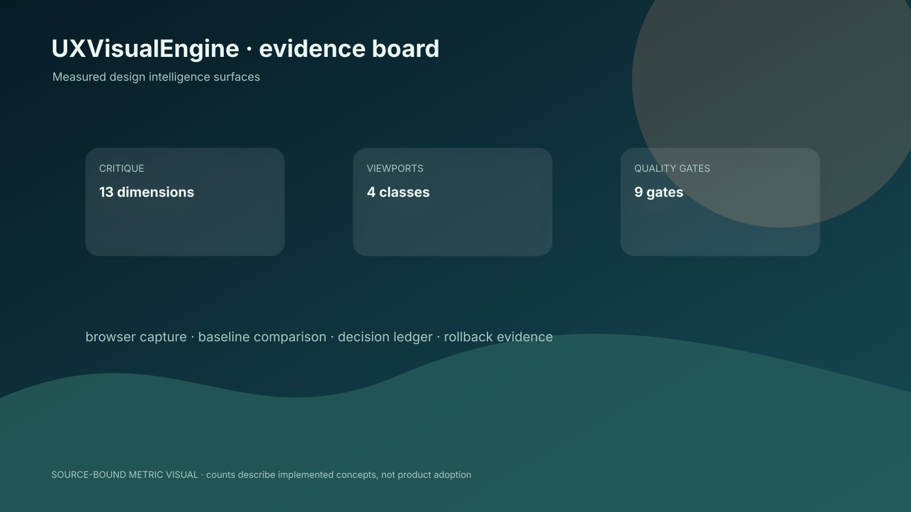

# UXVisualEngine

> Inspect the interface. Make the next decision obvious.

A local-first design intelligence engine that inspects projects, synthesizes design systems, captures rendered interfaces, critiques quality, detects convergence, and applies bounded improvements with evidence.

[CLI entry point](src/cli/uxve.ts) · [NOAERTH](https://www.noaerth.com)



## The visual improvement loop

UXVisualEngine turns a project into inspectable design evidence. It infers the framework, routes, components, tokens, and dependencies; retrieves design knowledge; synthesizes a design system; captures a rendered interface; critiques it across multiple dimensions; runs QA and originality checks; and only then considers a bounded improvement with rollback.



```text
infer → retrieve → synthesize → capture → critique → QA/originality → improve → verify/rollback
```

## Use it locally

```bash
`pnpm install`
`pnpm uxve doctor`
`pnpm uxve review .`
`pnpm uxve capture http://localhost:3000`
`pnpm run verify`
```

The documented modifier provider is deliberately narrow and requires explicit configuration. `pnpm uxve improve .` is a dry run; applying changes requires `--apply` and a configured provider.

## Evidence board



| Measurement | Meaning |
|---|---|
| 13 critique dimensions | Source-backed; see `v4/VERIFIED_METRICS.json` for definition and status. |
| 4 viewport classes | Source-backed; see `v4/VERIFIED_METRICS.json` for definition and status. |
| 9 quality gates | Source-backed; see `v4/VERIFIED_METRICS.json` for definition and status. |
| 3 default improvement iterations | Source-backed; see `v4/VERIFIED_METRICS.json` for definition and status. |

## Architecture

Next.js/React/TypeScript surface around engine, CLI, HTTP, MCP, optional browser/provider adapters, baselines, and decision memory. Playwright, axe-core, registries, and model critics are optional adapters rather than assumed capabilities.

## What it does not prove

- Provider-backed improvement requires a configured modifier.
- Rendered evidence and screen-reader behavior were not rerun here.
- Live readiness claims remain unverified.

Static source analysis cannot certify screen-reader behavior, focus order, live URLs, or visual quality. Rendered evidence is a required part of the intended proof loop.

## Source map

- `src/engine`
- `src/cli/uxve.ts`
- `src/mcp/server.ts`
- `package.json`
- `src/app/tokens.css`

## Status

Research-stage design infrastructure / active development. The strongest differentiator is the evidence-preserving loop, not a claim that every interface can be autonomously improved.
